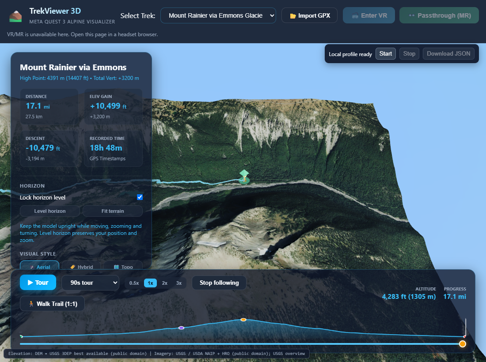

# First complete Rainier offline pack

The complete Rainier/Emmons v2 High public-source archive is now acquired, assembled and independently verified. It contains **5,337 sources: 523 DEMs and 4,814 images**, with the full current surrounding-model inventory through Z19. Enchantments remains in acquisition. Headset, signed APK and native performance acceptance remain open.

| Measured item | Bytes |
| --- | ---: |
| Original encoded source bodies | 5,706,785,778 |
| Stored archive components, including exact gzip DEM compression | 5,494,838,298 |
| Complete TAR, including manifest/headers/padding | 5,500,797,440 |

The approximately **5.50 GB** file is local: `.review-cache/prepared-route-packs/output/rainier-emmons.trekpack.tar`. Its SHA-256 is **`61e7db01374e65c724002cc57d64a56e0de9f8796a35ad41c08efda2c6ba3b25`**. The original-body sum is about 5.71 GB, separate from browser metadata/cache overhead and the earlier 18.3 GB uncompressed planning budget. The file is not committed, deployed to Surge or embedded in an APK.

The [full independent file verification](real-rainier-pack/file-verified.json) checks the exact current GPX/layout contract, actual original request provenance, every stored/original hash, bounded decompression and every source's production worker/Canvas coverage. It uses a native browser File and reports **zero external requests**. The approved original alternative mosaics remain intact; no masked pixels or heights are filled, imagery is not resized and no source body is re-encoded for quality savings.

## Windows Node file-size recovery

The first real archive exposed a PC-only failure after all source acquisition had completed. On this machine, **Windows / Node v24.21.0**, `fs.statSync` reports the actual 5,500,797,440-byte file, while `fs.openAsBlob().size` reports **1,205,830,144**: a difference of exactly **4,294,967,296 bytes**. The writer's final bounded header check therefore rejected the complete file as truncated. The [same-file reproduction](real-rainier-pack/node-file-size.json) records the observed environment and values. This is a measured failure on that runtime, not a claim that every Node/platform version behaves identically.

The writer now uses a [bounded file reader](../../../scripts/offline-pack-file.mjs) with the filesystem's true size, safe numeric offsets, a 32 MiB maximum slice and file-change guards. It never constructs a whole-archive Node Blob. A real filesystem regression reads bytes beyond 4 GiB, and smaller tests cover streams, range bounds, file mutation and closure. The existing real-component archive remains byte-identical and its cancellation/corruption/native-file checks pass.

The [recovery record](real-rainier-pack/recovery.json) rechecks all **5,337 stored/original payload hashes** and exact current-plan provenance in the existing assembled file. It publishes the retained file and complete inventory without any source downloads, data edits or re-encoding. Independent browser coverage verification follows before import acceptance. The final source offset is **5,499,400,704**, also beyond 4 GiB.

`scripts/recover-offline-route-pack.mjs --route rainier-emmons` requires a failed producer with every current source validated, matching route/inventory identity and matching original/stored byte totals. It shares the producer's exclusive route lock, rejects mismatched/corrupt/incomplete files, preserves failed inputs and cannot overwrite an already-complete published pack. The normal command uses Node 24 with `--experimental-transform-types`. It is a recovery tool for this local preparation pipeline, not a general importer or a substitute for the native-file verifier.

Three payload regressions cover identity/gzip recovery, wrong route, corruption and cancellation; three reader regressions include the actual large-offset file. Six resource-retry regressions also distinguish temporary downloads from decoder/disk/permanent failures, respect longer service waits and stop on cancellation. The complete suite passes **828 Windows tests with five skips**, and both TypeScript checks pass. These are PC tooling changes; the published application remains the measured `4d0a5f0-2026-10-22T20:47:14.831Z` build.

## Real PC browser import and offline tour

The [actual import record](real-rainier-pack/import.json) uses the production file input with the native 5.50 GB File and real persistent IndexedDB. The test pauses after **138 sources / 255,293,856 original bytes**, verifies that staging is invisible to rendering, closes the entire browser and resumes from the same file. It retains the prefix across restart, makes **zero prefix rewrite requests**, and records exactly **5,337 source writes** before atomic ready publication. Clearing the temporary source cache preserves the ready pack.

After import, browser-reported total origin use is **5,736,215,633 bytes**, including approximately 5.727 GB of IndexedDB and 9.03 MB of cached shell resources. This is a browser estimate, not an exact OS allocation or installed APK size. The observed quota changes during the run; neither this estimate nor the raw 18.3 GB planning budget guarantees a fixed device capacity.

The [offline browser evidence](real-rainier-pack/browser-summary.json) closes and reopens the dedicated browser with networking disabled **before navigation**. The exact cached shell is controlled by its service worker, the selected route is Rainier, and the normal profile is `quest-high` with real USGS 3DEP elevation. The real Play control completes the 90-second, 1× tour and stops at progress 1 with camera follow. Fine real DEM is under the hiker in **180 of 180 samples**: rendered cells are approximately **4.98 m**, while the requested source grid samples are approximately **1.00 m** apart. Requested sampling does not establish the native survey resolution of every underlying dataset. Camera displacement is recorded in scene units, not real-world route metres.

The ordinary tour uses overview imagery as its camera pulls back. Separately, three cold-offline close-ups inspect ground **500 m beside** the 15%, 50% and 85% route positions, outside the overview hiker beacon. The normal camera and all markers/quality budgets remain active. The check requires a real center terrain-ray hit near the selected point, its supplying **Z19 tile**, and at least 95% requested imagery coverage with no pending/queued/in-flight work for three consecutive samples. All three reach **100% coverage / zero pending requests**. [Inspection evidence](real-rainier-pack/inspection-summary.json) records actual GeoPlatform NAIP / USGS NAIP Plus suppliers, source detail and timings. A zoom request is not a guarantee of corresponding native photographic resolution; close magnification can exceed the source's detail.

Cold startup, the full tour and close-ups record **zero external source attempts and zero page exceptions**. PC tour draw counts are not stereo Quest frame-delivery evidence. This establishes complete real-file PC import and offline High operation for Rainier, not native 72 Hz, headset comfort/manipulation, Quest file selection, signed APK installation, or initial offline launch of an unprovisioned device.

## Repeating the PC acceptance

Run `node scripts/check-real-offline-route.mjs` from the repository root after preparing and independently verifying the complete archive. It defaults to Rainier and the measured deployed site. It requires matching `dist/build-info.json`, entry asset and runtime source; the diagnostic helper is built from the same source revision. It uses local Windows Edge and the existing Playwright runtime, a dedicated persistent profile, an exclusive acceptance lock, and blocked external source origins. It does not query the headset or use private credentials.

- `--preflight` checks selectors/helper/cached shell only; it does not accept a route pack.
- `--wait` waits for a complete verified archive, and stops if acquisition/verification fails.
- `--tour-only` repeats cold startup and the full real-UI tour against an existing accepted import.
- `--inspect-only` repeats the three close-up checks against that import.

`TREK_REAL_ROUTE=enchantments-dragontail` selects the other default; `TREK_REAL_OUT`, `TREK_REAL_URL` and `TREK_PLAYWRIGHT_MODULE` select the evidence directory, site and local Playwright module. The script uses `.review-cache/real-route-offline/browser-profile` and will not silently replace an existing target-route pack during a fresh import test. Preserve the real data; use the repeat modes for this existing profile. Create `.review-cache/real-route-offline/acceptance.stop` to stop only the acceptance test. Review its state before removing a pause marker or stale lock. This lock and marker are separate from source preparation and independent file verification.

## Enchantments remains in acquisition

Enchantments stopped at sources 283 and 509 after exhausting HTTP 502/504 retries. All completed originals were retained. The resumed queue has passed both requests without lowering DEM resolution or relaxing required coverage. If normal per-URL retries exhaust on a transient download failure, preparation now keeps its ordered prefix and waits **two minutes, then five minutes**, for at most two additional resource cycles. Invalid coverage/decoder errors, permanent responses, longer service-requested waits, disk failures and cancellation do not receive those retries. Progress writes are serialized across both source tasks and the ordered writer.

The independent verification watcher has reverified the same Rainier archive hash and waits for Enchantments publication. Current progress files identify the live acquisition state; an active queue is not completed Enchantments acceptance. Both full default packs and installed/native tests remain required for the broader delivery milestone.
