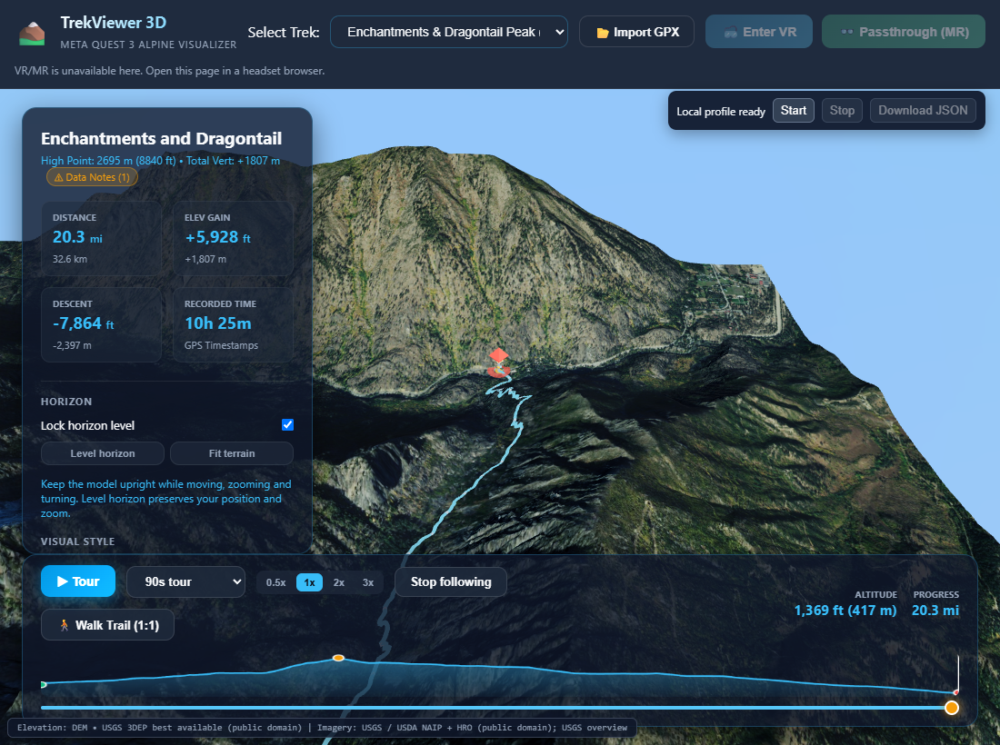

# Both default route packs: complete PC offline acceptance

Reviewed October 24, 2026. Rainier and Enchantments now have complete local High public-source archives, independent whole-file verification, real browser import/restart/resume, cold offline tours and Z19 terrain inspection. The underlying acquisition/verification/browser records completed on October 23 UTC. Their exact measured application remains `4d0a5f0-2026-10-22T20:47:14.831Z`; this checkpoint publishes PC tooling and evidence without rebuilding the website.

| Route | Sources (DEM + imagery) | Archive bytes | Original encoded body bytes |
| --- | ---: | ---: | ---: |
| Rainier / Emmons | 523 + 4,814 | 5,500,797,440 | 5,706,785,778 |
| Enchantments / Dragontail | 793 + 7,384 | 10,388,030,464 | 10,690,405,069 |
| Both | 1,316 + 12,198 | 15,888,827,904 | 16,397,190,847 |

These are **5.50 GB / 10.39 GB archives**, using decimal GB. The previous 18.3 GB / 27.8 GB values are raw planning budgets, separate from measured encoded files and browser storage. Lossless gzip DEM components preserve exact original encoded bodies; imagery is not resized or re-encoded. Packs retain the full current surrounding-model High v2 inventory through Z19, using approved public USGS / GeoPlatform sources.

## Local files and integrity

Both files are retained in `.review-cache/prepared-route-packs/output/`:

- `rainier-emmons.trekpack.tar`: SHA-256 `61e7db01374e65c724002cc57d64a56e0de9f8796a35ad41c08efda2c6ba3b25`.
- `enchantments-dragontail.trekpack.tar`: SHA-256 `8a20084c7337ee10f46a2ea5ac3638fab172ae8bc1d27010368bb891a6850428`.

The [transfer metadata](default-packs/manifest.json) records filenames, exact bytes, GPX/layout fingerprints, source counts and archive hashes. It is review metadata, not a deployed download API. The files are local deliverables; they are not committed, uploaded to Surge or embedded into an APK. Use Settings → Import route pack after copying a file to the target device. Keep playback paused and exit XR during import; reselect the same file after interruption.

The independent native browser File checks validate the entire current contract, actual supplying request provenance, every stored/original hash, bounded decompression and production worker/Canvas coverage: [Rainier](default-packs/rainier-emmons/file-verified.json), [Enchantments](default-packs/enchantments-dragontail/file-verified.json). Both record zero external requests. A later [bounded streaming fingerprint recheck](default-packs/fingerprint-recheck.json) confirms both retained archives still match those certificates without downloading or changing sources. Enchantments' final source offset is 10,386,814,464, exercising the corrected large-file writer beyond 4 GiB.

## Actual import, storage and offline rendering

Both tests use production file inputs, native local Files, persistent IndexedDB and the exact cached application shell. [Rainier import](default-packs/rainier-emmons/import.json) pauses at 138 sources / 255,293,856 bytes; [Enchantments import](default-packs/enchantments-dragontail/import.json) pauses at 129 sources / 240,502,086 bytes. Each closes the entire browser, resumes without rewriting the retained prefix, performs exactly one source write per final asset, keeps staging invisible, and preserves the ready pack when temporary source storage is cleared.

Both packs coexist in the same dedicated browser profile. After Enchantments import, the browser reports **16,460,170,158 bytes of total origin storage**, including 16,451,125,204 bytes of IndexedDB and about 9.04 MB of cached resources. This approximately **16.46 GB** value is an observed browser estimate. It is not an exact OS footprint, a fixed quota or installed APK/device storage measurement. Importing an archive can also require keeping the original file alongside browser-owned data until the user removes it.

Each test reopens the browser with networking disabled **before navigation**, confirms the service-worker-controlled exact shell, then plays the real 90-second, 1× High tour with camera follow. Both finish at progress 1 and stop normally. [Rainier](default-packs/rainier-emmons/browser-summary.json) and [Enchantments](default-packs/enchantments-dragontail/browser-summary.json) each have fine real DEM beneath the hiker in **180/180 samples**, with rendered cells approximately 4.98 m and 5.00 m respectively. Requested source-grid spacing is recorded separately; it does not establish the native survey resolution of every underlying dataset. Camera displacement is in scene units.

Separate cold-offline close-ups inspect ground 500 m beside the 15%, 50% and 85% route positions, outside the overview hiker beacon. They require the supplying Z19 tile at a current center terrain-ray hit and three consecutive settled samples. All six views reach **100% requested imagery coverage with zero pending/in-flight work**: [Rainier inspection](default-packs/rainier-emmons/inspection-summary.json), [Enchantments inspection](default-packs/enchantments-dragontail/inspection-summary.json). Enchantments' actual fine imagery supplier is GeoPlatform NAIP; its measured settling times are approximately 6.1, 9.5 and 15.2 seconds. The ordinary pulled-back tours use overview imagery. Requested zoom does not guarantee matching native photographic detail.

Cold startup, tours and inspections record **zero external source attempts and zero page exceptions**. These are PC browser results using normal `quest-high` budgets, not native stereo frame-rate, clarity, comfort or hand/controller acceptance. No headset was queried or launched.

## Recovery changes and remaining work

The [large-file recovery and completed-archive reuse](../review-2026-10-22/REAL_RAINIER_PACK.md) preserve the Rainier archive and remove false queue failure when resuming a completed first route. The later adaptive service cooldown grows from 2 to at most 30 minutes after repeated exhausted transient failures while preserving every approved source as an immediate fallback. A controlled 1,000-source comparison makes four exhausted-primary probes instead of nine while accepting identical original imagery; this is not a service wall-time or native performance benchmark.

The actual restart revalidates **3,448 Enchantments originals / 3,413,234,016 bytes**, with [zero changed hashes, rewritten originals or prefix redownloads](../review-2026-10-22/real-rainier-pack/cooldown-resume.json). It subsequently completes all 8,177 sources; both preparation and independent verification queues finish successfully. The Windows suite passes **834 tests with five skips**, and TypeScript checks pass. Runtime source, public assets, quality budgets and the measured hosted build are unchanged.

Signed APK/toolchain preparation, native file selection/import, installed offline startup, native visual/performance/lifecycle acceptance, geographic pack indexing, browser export and a separately validated source-native bake remain open. Other imagery styles/providers and experimental detail settings can still require online sources. The current full-file and PC acceptance milestone is complete for both selected defaults.
